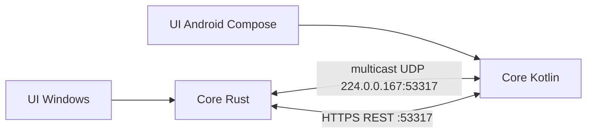

# FileSend - Architecture technique

> Version 1 · 2026-11-08

## 1. Résumé

| Couche | Choix | Pourquoi | Alternative écartée |
|---|---|---|---|
| Interface Windows | Tauri 2 (décidé en D2), interface HTML/CSS/JS sans framework ni bundler. Fenêtres créées à l'ouverture et détruites à la fermeture : aucun WebView2 au repos | Peu de code, effets de fenêtre natifs, zone de notification | WinUI 3 (Mica/acrylique documentés, mais runtime plus lourd à distribuer) : repli si D2 échoue |
| Logique Windows | Rust (même processus Tauri) | Serveur HTTPS, flux de fichiers, faible mémoire | .NET, Electron (poids) |
| Interface Android | Kotlin + Jetpack Compose, flou via `Window.setBackgroundBlurRadius` (API 31) | Natif, APK petit, API de flou officielle | Flutter, Tauri Android (une seule base mais plus de poids et moins de contrôle système) |
| Logique Android | Kotlin pur (module ndroid/core, testable sur la JVM) : serveur HTTPS maison sur SSLServerSocket, client HttpsURLConnection, certificat ECDSA P-256 encodé à la main, kotlinx.serialization-json | Même protocole que Windows, aucune bibliothèque réseau (poids, surface d'attaque) ; le serveur HTTP du JDK n'existe pas sous Android | Ktor/NanoHTTPD (dépendance), cœur Rust via JNI (complexité) |
| Protocole | Protocole propre FileSend v1 (REST sur HTTPS, découverte multicast UDP), de forme voisine de LocalSend ; voir `docs/protocol.md` | LocalSend v2.2 n'a pas de champ de chemin (pas de dossiers) et n'indique aucune licence | Suivre LocalSend (pas de dossiers), Quick Share (propriétaire) |
| Stockage | Aucun serveur ; un fichier de config minuscule (identité) | Rien à synchroniser | Base de données |
| Tests | Rust : `cargo test` ; Android : JUnit + tests instrumentés ; vecteurs de protocole communs | Une seule suite de conformité pour les deux implémentations | Tests manuels seuls |
| Distribution | Installeur Windows (Tauri) + APK signé, via dépôt | Pas de store au MVP [H2] | Microsoft Store, Play Store (examen, frais [À vérifier]) |

## 2. Contexte existant

Nouveau projet, aucun code existant.

## 3. Composants



Chaque core contient : **Identité** (nom, certificat auto-signé, empreinte) · **Découverte** (annonces multicast, écoute, repli par sondage) · **Serveur** (endpoints de réception) · **Client** (envoi en flux) · **Sécurité des chemins** (assainissement) · **Notifications** (adaptateur de plateforme). La logique est séparée des API de plateforme pour être testable.

## 4. Local ou serveur

| Fonction | Où | Service externe | Clé secrète | Repli |
|---|---|---|---|---|
| Découverte | Local | Aucun | Non | Sondage du sous-réseau |
| Envoi/réception | Local, appareil à appareil | Aucun | Clé TLS locale générée sur l'appareil | Message "Introuvable" |
| Notifications | Local | Aucun | Non | Statut dans E1 |
| Mises à jour | Manuelles (téléchargement) | Dépôt de code | Non | Sans objet |

Contrainte "aucun service payant" respectée ligne par ligne : aucun service externe.

## 5. Modèle de données

- **Identité** (fichier de configuration, version 1) : `alias` (texte, ≤ 32 car.), `fingerprint` (SHA-256 du certificat), certificat et clé privée (stockés dans le dossier de données de l'application, jamais exportés).
- **Séance de transfert** (mémoire uniquement) : `sessionId`, expéditeur, liste de `{id, relativePath, size, sha256?}`, état. Rien n'est conservé après la fin.
- **Appareil découvert** (mémoire) : `alias`, `deviceType`, `ip`, `port`, `fingerprint`, `lastSeen`.

## 6. Interfaces et intégrations

Contrat figé dans `docs/protocol.md` (D1). Éléments :
- Annonce : paquet UDP multicast (alias, version, deviceType, port, protocole, empreinte) ; réponse par enregistrement direct (`register`).
- `prepare-upload` : l'expéditeur envoie la liste des fichiers ; le receveur renvoie accord ou refus (c'est ici que la notification F3 est posée) puis un jeton par fichier.
- `upload` : un fichier par requête, corps en flux, jeton de séance.
- `cancel` : annulation par l'un ou l'autre.
- Les chemins relatifs transportent les dossiers.

## 7. Authentification et permissions

Pas de compte. Consentement humain par transfert (H5). Le certificat auto-signé garantit le chiffrement, pas l'identité : sur un Wi-Fi hostile un appareil peut se faire passer pour un autre. Mitigation MVP : l'alias affiché est celui annoncé et le receveur voit toujours l'expéditeur avant d'accepter. Épinglage de l'empreinte et appareils de confiance : V2.

## 8. Sécurité, validation et erreurs

- **Frontière réseau** : TLS obligatoire ; corps limités ; nombre de fichiers et taille plafonnés par séance (valeurs en configuration) ; aucune requête d'écriture avant accord.
- **Chemins** : normalisation, rejet de `..`, chemins absolus, lettres de lecteur, flux de données alternatifs et noms réservés Windows, séparateurs mixtes, longueurs excessives ; résolution finale vérifiée sous le dossier de réception.
- **Collisions** : suffixe ` (n)` ; jamais d'écrasement.
- **Écriture** : fichier temporaire puis renommage ; suppression du partiel en cas d'échec.
- **Erreurs** : message utilisateur parmi quatre raisons, détail dans un journal local sans contenu de fichier.
- **Secrets** : aucune clé réelle versionnée ; clé TLS générée au premier lancement ; `.gitignore` exclut les dossiers de données ; `.env.example` sans objet (aucune variable).

## 9. Dépendances

| Dépendance | Rôle | Licence | Coût | Alternative |
|---|---|---|---|---|
| Tauri 2 | Fenêtre, zone de notification | À vérifier | 0 | WinUI 3 |
| Bibliothèques Rust (serveur HTTPS, TLS, multicast) | Core Windows | À vérifier lors du choix | 0 | Écrire à la main |
| Kotlin, Jetpack Compose, serveur HTTP embarqué avec TLS | Core et UI Android | À vérifier lors du choix | 0 | Sockets bruts |

Aucune version ni nom de paquet n'est figé ici : à vérifier dans T1 et T6 dans la documentation officielle.

## 10. Tests

Unitaire (assainissement des chemins, collisions, état de séance), intégration (deux instances du core sur la même machine, ports distincts, multicast activable/désactivable), vecteurs de protocole partagés entre Rust et Kotlin, manuel sur appareils réels. Commande unique Windows : `cargo test` (depuis `windows/core`) ; Android : `./gradlew test`.

## 11. Build, déploiement et maintenance

Installeur Windows et APK signé produits en local ; mise à jour manuelle. Première exécution Windows : invite du pare-feu à accepter (documentée). Aucune exploitation serveur.

## 12. Coûts récurrents

| Poste | Coût | Source |
|---|---|---|
| Hébergement, API, serveur | 0 | Aucun service |
| Stores (si publication) | [À vérifier] | À consulter au moment de publier |

## 13. Décisions d'architecture

- **ADR-1 - Deux implémentations natives plutôt qu'une base commune** : poids et accès aux API de flou/notifications ; coût : protocole implémenté deux fois, compensé par des vecteurs de conformité communs.
- **ADR-2 - Protocole propre, forme voisine de LocalSend** : décidé en D1 (2026-11-08). Port 53318, `relativePath` pour les dossiers. Pas d'interopérabilité avec LocalSend.
- **ADR-3 - Pas d'appairage au MVP** : consentement par transfert ; menace connue (section 7), traitée en V2.
- **ADR-5 - Notification Windows = fenêtre propre** (D5) : seul moyen d'avoir Accepter/Refuser ; coût : pas dans le centre de notifications Windows, et masquée par une application plein écran exclusif [À vérifier].
- **ADR-6 - minSdk 29 (Android 10)** : écriture dans Téléchargements via MediaStore.Downloads sans permission de stockage [À vérifier] ; Android 9 et antérieurs non pris en charge.
- **ADR-7 - Le repli par sondage est le chemin normal** (2026-11-08) : le multicast peut être bloqué par le réseau (constaté), donc le sondage du /24 démarre 1,5 s après le lancement si aucun appareil n'est connu. Interface multicast du PC = celle de la route par défaut.
- **ADR-4 - Android reçoit app ouverte** : évite un service permanent (H3).

## 14. Arborescence proposée

```
FileSend/
  product/
  docs/protocol.md
  protocol-tests/        vecteurs JSON partagés
  windows/
    core/                bibliothèque Rust filesend-core, tests, outil filesend-dev
    app/                 Tauri 2 : src/main.rs, ui/ (index, toast), capabilities/, tauri.conf.json
  android/
    core/                Kotlin pur : protocole, serveur, client, identité, tests (JVM)
    app/                 Compose, MediaStoreSink (coquille en T6)
  protocol-tests/        vecteurs JSON partagés Rust/Kotlin
  tools/                 check-contrast.mjs
```
